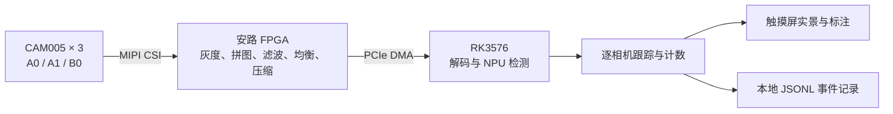

# 基于 FPGA 与 RK3576 的三路图像采集与智能分析系统

2026 年全国大学生嵌入式芯片与系统设计竞赛 FPGA 创新设计赛道 · 安路选题三

系统通过三个 CAM005 相机观察不同方向。FPGA 将三路灰度图拼成一帧，完成高斯滤波、受限直方图均衡和压缩，再经 PCIe 送入 RK3576。板端 NPU 用一次 YOLOv5n 推理检测三路画面中的人车，各视角分别关联短时目标并保存观测事件。设备保持供电时，操作人员可以断开电脑，通过触摸屏启停识别、切换总览和单路放大画面。

| 目录 | 可以查看或验证的内容 |
| --- | --- |
| [fpga](fpga/) | 项目图像处理 RTL、仿真台架和测试方法，包括拼图接缝处的高斯滤波与限制亮度增幅的均衡逻辑。 |
| [soc](soc/) | 逐相机目标关联、人车统计、事件写入、原生显示和触摸界面的源码。可在普通电脑上运行跟踪与事件记录测试。 |
| [measurements](measurements/) | 四帧 PCIe 传输字节样本和同模型八次固定输入推理的计时记录。 |

## 板上实测

| 测试 | 结果 |
| --- | --- |
| 三路实时拼图，75 秒观测窗口 | 每秒输出 49.257 个新识别结果，每秒完成 49.002 个不同源帧的 XShm 显示提交。 |
| 两个批段末的四帧样本 | 原始灰度数据共 8,294,400 字节，含封装的传输记录共 3,073,256 字节，减少 62.95%。 |
| 同模型固定输入，两个线程各调用四次 | 从设置输入到释放输出的完整 C 接口耗时中位数 15.078 ms，P95 为 26.077 ms。 |

## 完整工程与来源

本仓库公开项目图像处理和板端分析模块，供评审浏览、仿真和复核。完整 TD 工程、板测 SRAM 位流、SoC 部署源码和第三方依赖说明见赛事提交 RAR。该文件为 **5,716,932 字节**，SHA-256 为 `3bd52b75cdb83968ad7c352d83b1a50890a957f7b5faf0e5f30e1df2381bca6a`。

硬件平台为 MLK-AFH03 / AFC03，使用 FMC_VID007 子卡和 RK3576。整机还依赖安路 TD、厂商接口 IP、Rockchip BSP 与 RKNN 运行环境。使用作品时请保留原始版权声明；用于教育用途时请注明来源。赛题指南对商业培训用途另有规定。
